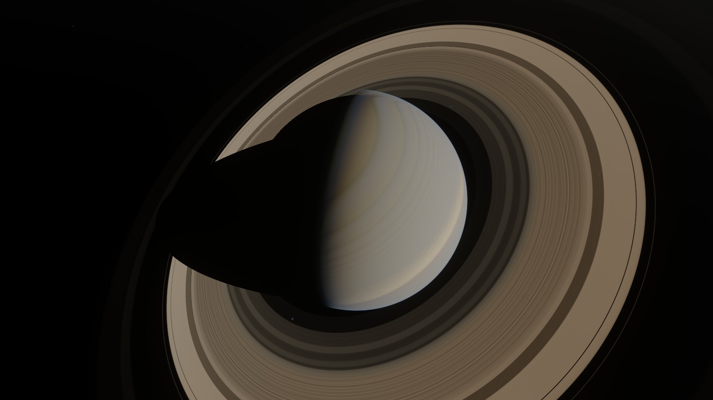
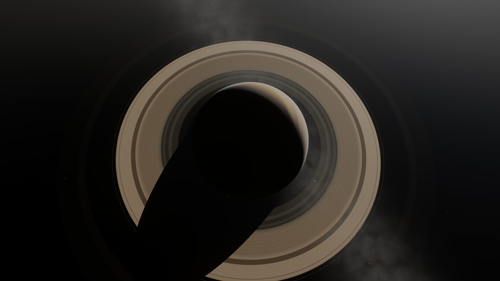
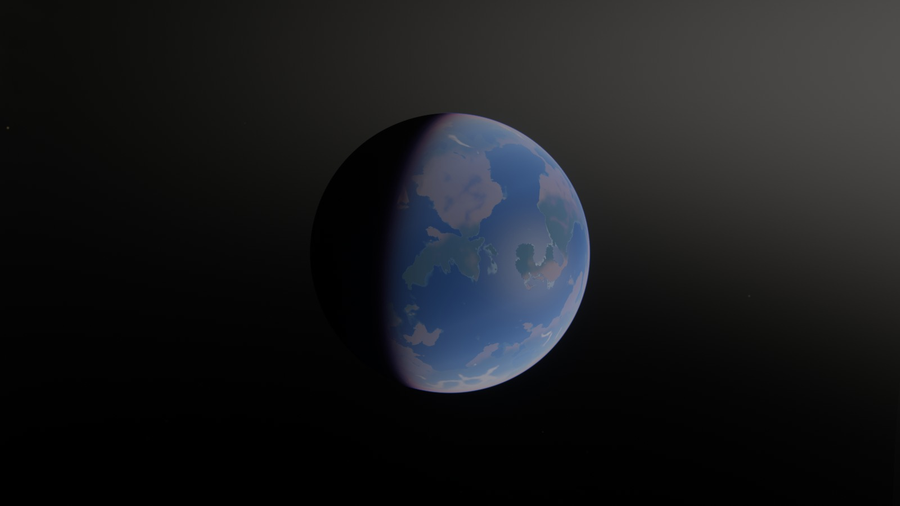
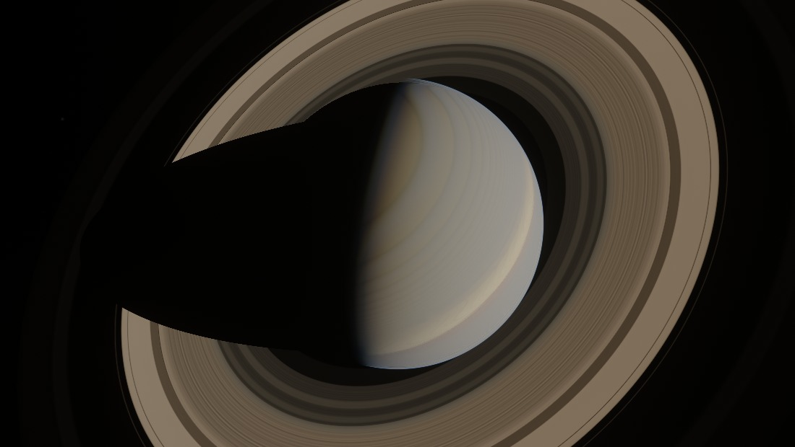
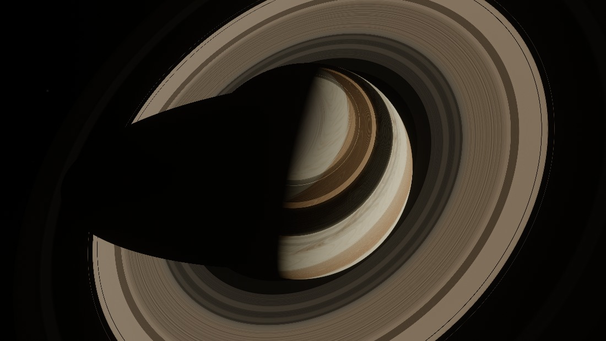

# web-solar

A real-time solar system written from scratch on WebGPU, with no engine or rendering library.
Saturn's rings are rendered as a statistical medium rather than as particles, planet surfaces
carry a slope-moment pyramid, atmospheres are physically based, and you fly around all of it
with a free camera that works from 20 km above the Moon to 30 AU out.



| Backlit, from inside Saturn's shadow | Earth |
|---|---|
|  |  |

## The idea

This is a sibling of [web-ocean](../), and it exists to push that renderer's central trick as
far as it will go. The ocean's interesting part was never the FFT waves — it was one idea,
applied once:

> **When detail drops below a pixel, stop sampling it and start integrating its distribution.**

The ocean did this with LEAN mapping: it stored mip-mapped first and second moments of the
wave slopes, so sub-pixel waves became the correct anisotropic roughness instead of becoming
aliasing. That bought it a sea that is a sharp spark of sun glitter up close and a smooth
sheen at the horizon, with nothing crawling in between.

The solar system is a better stage for that idea than the ocean is, because the scale range is
ten orders of magnitude instead of four, and because one of its objects makes the idea
unavoidable. Here it is applied five times:

| Where | What falls below a pixel | What is integrated instead |
|---|---|---|
| **Saturn's rings** | ~10^14 individual particles | mip pyramid of the first *and second* moments of optical depth |
| **Planet surfaces** | thousands of craters per pixel | mip pyramid of the slope moments (LEAN), feeding a rough-surface BRDF |
| **Close-range relief** | octaves finer than the stored map | resolved octaves shade; unresolved ones are added to the slope variance |
| **Gas giant bands** | turbulence finer than a pixel | octaves band-limited by pixel footprint, their variance folded into roughness |
| **Stars and distant planets** | point sources, smaller than a pixel | flux splatted into a normalised Gaussian, so energy is conserved |

The rings are the case where there was never an alternative. You cannot draw 10^14 particles,
so the only question is whether you integrate the distribution correctly or incorrectly.

## Run it

You need a recent Chrome with WebGPU and a reasonably capable GPU. On a laptop, force Chrome
onto the dedicated GPU in the Windows graphics settings, or it will fall back to the
integrated one.

Open `solar.html` directly in the browser. `solar.min.html` is the same page minified (74 KB
instead of 148 KB). Both are self-contained and work from `file://`.

To run from source:

```
npm install
npm start        # serves http://localhost:8080/
```

After editing anything under `js/`, run `npm run build` to regenerate both bundles.

## Controls

| Input | Action |
|---|---|
| Click the canvas | Capture the mouse (Esc releases it). Holding the right mouse button also works. |
| Mouse | Look around |
| W A S D | Move |
| Space or E / Q or C | Up / down |
| Shift | 6x speed |
| Mouse wheel | Change speed |
| 0 – 9 | Jump to the Sun, Mercury, Venus, Earth, Mars, Jupiter, Saturn, Uranus, Neptune, Pluto |
| `[` `]` | Change target (includes the moons) |
| G | Go to the current target |
| H | Settings panel |

Flight speed scales with the distance to the nearest surface, which is the only way one
control can feel right both two kilometres above Europa and twenty AU out in the dark. The
camera holds station in the target body's frame — Earth moves at 30 km/s and the time scale
multiplies that, so an inertial camera would be left behind within a couple of frames.

URL parameters are handy for testing. `?w=2560&h=1440` forces the render resolution,
`to=Saturn` picks the body, `d=5.5` sets the distance in body radii, `ph=152` sets the phase
angle (small = sun behind you, large = backlit), `fov=16` zooms, `ui=0` hides the HUD, and any
settings key works too, for example `ringAlbedo=0.95&timeScale=20000`.

`dbg=1` shows raw albedo, `dbg=2` shows the LEAN slope sigma, `dbg=3` point-samples the ring
profile instead of prefiltering it, and `dbg=4` keeps the mip average but drops the second
moment.

## How it works

### Rings

The ring system is a radial optical-depth profile, 4096 samples from 1.0 to 3.2 Saturn radii,
built procedurally with the real structure: the tenuous D ring, the C ring with its plateaus,
the optically thick and strongly banded B ring, the Cassini Division (which is not empty), the
A ring with a chirped density-wave train and the Encke and Keeler gaps, the clumpy F ring, and
the barely-there G and E rings. The Keeler gap is 35 km wide — about one texel of the profile,
and far below one pixel for almost any camera.

That profile is stored as a **mip pyramid of the first and second moments of tau**, and the
shader picks the level from the pixel's radial footprint, computed analytically from the
neighbouring camera rays. Both moments are needed, because the exponential of an average is
not the average of the exponential: `E[e^-x] ≈ e^-E[x] (1 + Var[x]/2)`. A pixel that is half
empty and half tau=2 is substantially brighter than a pixel of uniform tau=1. Keeping only the
mean gets the sharpness right and the brightness wrong.

Scattering is a Chandrasekhar slab with Hapke's isotropic-multiple-scattering closure,
`R = (w/4) · μ₀/(μ₀+μ) · [P(g) + H(μ₀)H(μ) − 1]`, times the finite-depth saturation. The
`H(μ₀)H(μ) − 1` term is what carries light that bounced more than once between particles;
without it the B ring comes out about three times too dark, charcoal where it should be nearly
as bright as the planet. The particle phase function is a two-term Henyey-Greenstein with a
strong backward lobe, and the opposition surge — shadow hiding plus coherent backscatter —
multiplies the singly scattered part only.

Both shadows are analytic: the planet's shadow thrown across the rings, and the rings' shadow
banding the planet's cloud deck. When the sun is on the far side the shader switches to the
transmission solution, which is why the thin C ring and the Cassini Division glow while the
dense B ring goes dark — the backlit view at the top of this page.

At grazing angles the radial footprint explodes, which drives the lookup to the coarse levels
on its own. The rings fade into a correct smooth sheen, and at exactly edge-on the path length
through the layer diverges, so they collapse to the thin bright line they really are.

**This is the claim the project is built on, so it is worth seeing failed.** Same frame, same
camera; the only difference is that the right-hand image point-samples the profile instead of
prefiltering it:

| Prefiltered (`dbg=0`) | Point-sampled (`dbg=3`) |
|---|---|
|  |  |

Measured over the lit pixels of a wider frame, point sampling raises high-frequency energy by
**53%** (4.76 → 7.29 mean absolute difference between adjacent pixels) — that is the moiré.
Dropping only the second moment and keeping the mip average lands in between at 5.17, and
makes the rings about **5% too dark**, which is the `Var/2` term doing exactly what it claims.

### Surfaces

Nine bodies get a 1024×512 equirectangular map generated once at start-up on the GPU: Mercury,
Earth, the Moon, Mars, Io, Europa, Ganymede, Callisto and Pluto. Each has its own recipe —
maria and ray systems on the Moon, the hemispheric dichotomy and a rift canyon on Mars,
sulphur and paterae on Io, lineae on Europa, grooved sulci on Ganymede, Sputnik Planitia on
Pluto. The noise is evaluated in 3-D on the unit sphere, so there is no seam at the date line
and no pinching at the poles.

A second pass differentiates the height map in the local east/north frame — including the
`cos(latitude)` metric term — and writes the slope moments. The mip chain then box-averages
them, which is the whole point: averaging the second moments of a neighbourhood is what turns
geometry into a slope distribution. The shading reads that covariance and uses it directly as
the roughness of an Oren-Nayar diffuse lobe and an anisotropic Gaussian specular lobe, so a
planet seen from 10,000 km gets statistically correct roughness rather than crawling moire. A
shadow-hiding opposition surge, scaled by the same sigma, gives the Moon its famously flat
full disc and its hard terminator.

Inside about 0.004 radii the stored map runs out, and the shader adds procedural relief
directly — but only the octaves the pixel resolves. The rest are added to the slope
covariance, which is the same bargain the mip chain made, continued past its finest level.

Gas and ice giants are analytic instead of mapped: latitude-dependent zonal jets advecting a
band-limited turbulence field, with belts, zones, polar hoods, the Great Red Spot and
Neptune's dark vortex. Venus and Titan are opaque haze decks with super-rotating cloud
patterns.

### Atmospheres

The atmosphere follows Hillaire's approach — transmittance and multiple-scattering lookup
tables, then a ray march — but the medium comes from uniforms, so Earth, Mars, Titan, Venus,
Jupiter and Saturn all run the same code with different coefficients. Only the body the camera
is nearest gets the full treatment; everything further out uses a short exponential-profile
march with no LUTs, which is all a disc a few pixels across can show.

Mars is the interesting one. Its sky is butterscotch because suspended dust absorbs blue in
the multiply-scattered light, yet the aureole around the sun is *blue*, because the same dust
has a strong forward diffraction lobe that favours short wavelengths. Giving the dust a
colour-dependent scattering coefficient and a separate colour-dependent absorption reproduces
both from one medium.

Atmospheres are composited independently of whether the surface was hit, so the limb glow
outside the solid disc comes from the same code path as the haze over the day side.

### Geometry and scale

Nothing is rasterised except full-screen triangles. Bodies are intersected analytically, which
is exact at any distance and gives the silhouette as a closed-form screen-space distance — so
the limb is analytically anti-aliased and there is no MSAA and no depth buffer anywhere. Gas
giants are oblate spheroids (Saturn is flattened by 9.8%), handled by squashing the ray along
the spin axis and reusing the sphere test.

Every distance on the GPU is in megametres and camera-relative. The CPU keeps absolute
positions in f64 and subtracts the camera before upload; that is the only reason one f32
shader can hold metre-scale surface relief and 30 AU of empty space at once. Positions come
from the JPL approximate Keplerian elements with centennial rates, Newton-solved, plus the IAU
pole directions and sidereal rotation rates; moons orbit in their parent's equatorial plane
(the Moon in the ecliptic).

Mutual occultation is analytic too, so moon shadows cross Jupiter, the rings shadow the
planet, and a body passing in front of the sun produces a real partial eclipse.

### Stars

Roughly 90 real bright stars with their catalogue positions, magnitudes and B−V colours — so
Orion, the Plough, Crux and Cassiopeia are where they should be — plus about 11,000 procedural
stars following a `10^0.6m` magnitude distribution and concentrating toward the galactic plane.
Colours come from B−V through Ballesteros' temperature fit and a Planck curve.

Each star's *flux* is splatted into a normalised Gaussian rather than point-sampled, so the
energy in a pixel is a continuous function of where the star falls: nothing twinkles under
camera motion and brightness survives a resolution change. Distant planets go through the same
path — once a body's disc drops below about 0.8 pixels the body pass stops intersecting it and
the CPU appends it to the splat buffer with the flux of a Lambertian sphere at the right phase
angle, cross-faded over one octave of angular size. Measured through the handover, the peak
brightness falls smoothly with no pop.

Behind that: the Milky Way as a band-limited procedural field with a bulge and dust lanes, and
the zodiacal light along the ecliptic with its gegenschein.

### Post-processing

HDR throughout, then an 8-level bloom, AgX tone mapping, a slight look transform and dithering
— carried over from the ocean renderer unchanged, which is what a scene containing both the
solar photosphere and a 14th-magnitude star needs.

## Checking the work

Two things run locally and neither needs a GPU to be useful:

```
npm run lint     # static checks on the WGSL
npm run check    # lint, then render a frame in headless Chrome
```

`lint.mjs` catches the three mistakes that are easy to make and miserable to diagnose from a
driver message: WGSL reserved words used as identifiers (`smooth` and `active` both bit during
development), functions called before they are declared (WGSL has no forward declarations),
and backticks inside comments, which silently terminate the JavaScript template literal the
shader lives in and turn the rest of the file into syntax errors.

`check.mjs` starts the dev server, points headless Chrome at the page and waits for it to
render a frame and POST the PNG back. The page forwards every WGSL compilation message to the
server, so a shader that does not compile shows up as a file and a line rather than as a blank
canvas. `--sw` forces the software adapter, which still runs the real shader compiler.
`lum.mjs` reports mean, peak and high-frequency energy of a PNG, which is how the prefiltering
numbers above were measured — aliasing does not move the mean, so looking at the mean alone
would have missed it.

## Performance

At 2560 by 1440 on an NVIDIA Blackwell card the GPU takes about 5.2 ms per frame, measured
while other programs were also using the GPU. The HUD shows FPS and GPU time where the browser
supports `timestamp-query`.

Cost is dominated by the body pass, which is one full-screen triangle that intersects every
body, marches the active atmosphere and composites the rings. Start-up generates the surface
maps, their moment pyramids and the ring profile once; after that the only per-frame CPU work
is the ephemeris and the body buffer.

## Known limitations

- **No cloud layer on Earth.** The white on the day side is snow and ice, not weather. Venus,
  Titan and the giants have cloud decks because those *are* the visible surface.
- Only the nearest atmospheric body gets the LUT-based treatment; the rest use a six-step
  analytic shell. Flying between two atmospheres shows a switch if you look for it.
- The ring shadow is applied to Saturn's cloud deck but not inside its atmosphere march.
- Two partially transparent bodies overlapping in one pixel composite in body order rather
  than in depth order. In practice this needs two atmospheres on the same pixel.
- Ring particle size distribution is not modelled; the phase function is a fitted two-term HG
  rather than Mie scattering off a size spectrum.
- Surface maps are 1024×512, so coastlines and crater rims are soft until the close-range
  procedural relief takes over. The three moment arrays cost about 190 MB of VRAM.
- Prime-meridian phase is arbitrary: rotation *rates* and pole directions are real, absolute
  longitudes are not. Moon orbits use mean elements, so they are approximate in detail.
- The sky background is held at a fixed display brightness rather than scaling with the
  automatic exposure. This is a deliberate break from physical — a real exposure that makes
  Neptune visible would also make the Milky Way 900 times brighter and white out the frame.

## Repository layout

| Path | Contents |
|---|---|
| `index.html` | Page shell, HUD, and settings panel styles |
| `js/main.js` | Device setup, ephemeris, resources, camera, per-frame loop |
| `js/wgsl/common.js` | Constants, uniform layouts, geometry, noise, crater fields |
| `js/wgsl/surf.js` | Surface map generation and the LEAN moment pyramid |
| `js/wgsl/rings.js` | Ring optical-depth profile and its scattering |
| `js/wgsl/atmo.js` | Atmosphere LUTs and the ray march |
| `js/wgsl/bodies.js` | The main pass: intersection, shading, compositing |
| `js/wgsl/sky.js` | Milky Way, zodiacal light, star splats, the sun |
| `js/wgsl/post.js` | Bloom and tone mapping |
| `js/wgsl/all.mjs` | Shader assembly, shared by the renderer and the linter |
| `lint.mjs` `check.mjs` `lum.mjs` | Static checks, headless render check, image metrics |
| `server.mjs` `build.mjs` | Dev server and the single-file bundler |

## License

MIT, matching the ocean renderer this grew out of.
